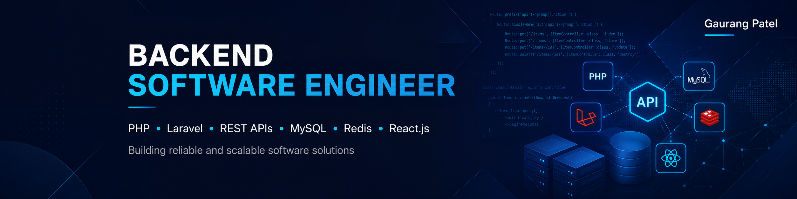
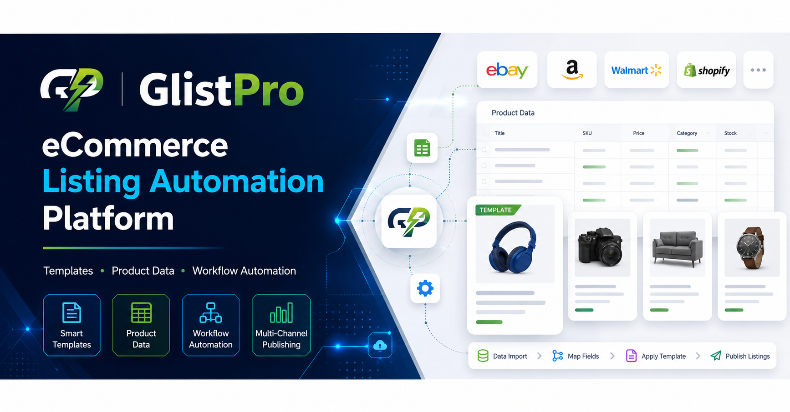

# Hi 👋, I'm Gaurang Patel

### Backend Software Engineer | PHP • Laravel • Yii2 • REST APIs • MySQL • Redis • React.js

London, United Kingdom · Full UK right to work · No sponsorship required

---

## About Me

Backend-focused Software Engineer with **5+ years of commercial experience** designing, developing and maintaining web applications, RESTful APIs and enterprise software platforms.

My core experience includes **PHP, Laravel, Yii2, MySQL, Redis, React.js, API integrations, database design, background processing and performance optimisation**. I have contributed to production systems across property management, financial services, B2B marketplaces, workplace platforms, eCommerce and high-traffic retail applications.

Alongside my current UK employment, I am building **GlistPro** as a part-time Founder and Backend Software Engineer.

---

## Core Technologies

**Backend**

**Frontend**

**Data & Infrastructure**

---

## Current Focus

- Building **GlistPro**, a Laravel-based eCommerce listing automation and template-management platform.
- Developing modular backend services using **PHP 8.3, Laravel 12 and MySQL**.
- Applying clean architecture, validation, authentication, logging and exception-handling practices.
- Using **Redis and Laravel queues** for caching and background-processing requirements.
- Improving practical knowledge of Docker, CI/CD and cloud deployment patterns.

---

## Featured Work

### GlistPro — eCommerce Listing Automation Platform

An early-stage SaaS-style platform designed to simplify repetitive listing-preparation workflows, improve product-content consistency and support structured product-data management.

**Current engineering focus:**
- Laravel application architecture and relational data modelling
- Reusable product-description templates
- Bulk data import and validation
- Database-backed workflow management
- API-ready backend services
- Future marketplace and third-party integrations

**Technologies:** PHP 8.3, Laravel 12, MySQL, Redis, Laravel Queues, REST APIs, React.js, Blade, Tailwind CSS, Git and Docker.

> The source repository is private while the MVP is in development.

---

### Orion Haus — Multi-Brand Property Management Platform

Contributed to a production property-management platform supporting multiple brands, properties and locations.

**Selected contributions:**
- Developed RESTful APIs for properties, listings, reservations, brands and locations
- Built housekeeping, inspection and operational workflow functionality
- Implemented JWT authentication and role-based access controls
- Improved performance through Redis caching and optimised database queries
- Integrated AWS storage and security services

**Technologies:** PHP, Laravel, React.js, MySQL, Redis, REST APIs, JWT, AWS S3 and AWS KMS.

> Commercial project details are summarised without publishing proprietary source code.

---

### Mini Lister — eBay Listing Automation Tool

Developed an internal Python and Flask application for JAH Product Ltd to automate branded eBay listing-description workflows.

**Selected contributions:**
- Generated reusable HTML listing templates from structured spreadsheet data
- Integrated SharePoint-hosted Excel data through Microsoft Graph API
- Built placeholder replacement, image-gallery and category-header functionality
- Added validation, logging and error handling
- Integrated the eBay Trading API for listing-description updates

**Technologies:** Python, Flask, SQLite, JavaScript, HTML/CSS, Microsoft Graph API, SharePoint/Excel data integration and eBay Trading API.

> The commercial source code is not public.

---

## Public Repositories

| Repository | Description | Technologies |
|---|---|---|
| [portfolio](https://github.com/gaurangkumar-patel/portfolio) | Personal software-engineering portfolio and project showcase | HTML, CSS, JavaScript |
| [supplier-product-parser](https://github.com/gaurangkumar-patel/supplier-product-parser) | Command-line tool for parsing supplier product files and counting unique combinations | PHP |
| [tillmate](https://github.com/gaurangkumar-patel/tillmate) | Mobile-friendly UK coin-weight and till cash-up calculator | JavaScript |
| [speech-to-text](https://github.com/gaurangkumar-patel/speech-to-text) | Browser-based multilingual speech-to-text application | HTML, CSS, JavaScript |
| [tictactoe-app](https://github.com/gaurangkumar-patel/tictactoe-app) | React-based Tic-Tac-Toe application with two-player and computer modes | React, JavaScript |

---

## Professional Highlights

- **5+ years** of commercial software-development experience
- Production experience with **Laravel, Yii2, MySQL, Redis and React.js**
- REST API design, third-party integrations and database optimisation
- Enterprise integrations involving **AWS, Azure AD, SharePoint, Microsoft Graph and eBay APIs**
- Experience across SaaS, property management, finance, eCommerce and B2B marketplace systems
- Strong interest in clean, maintainable and reliable backend engineering

---

## Certifications & Professional Development

- **micro1 Global Certification — PHP Backend Developer**
- **HackerRank Software Engineer Certificate**
- **Deloitte Australia Data Analytics Job Simulation — Forage**

---

## Connect

- **Portfolio:** [gaurangkumar-patel.github.io/portfolio](https://gaurangkumar-patel.github.io/portfolio)
- **LinkedIn:** [linkedin.com/in/gaurangpatel2326](https://www.linkedin.com/in/gaurangpatel2326)
- **HackerRank:** [hackerrank.com/profile/gaurangpatel3056](https://www.hackerrank.com/profile/gaurangpatel3056)
- **Email:** [gaurangpatel3056@gmail.com](mailto:gaurangpatel3056@gmail.com)

---

**Open to Backend Software Engineer, PHP/Laravel Developer, Software Engineer and backend-focused Full-Stack opportunities in the UK.**

